# Implemented Lens execution flow

```mermaid
flowchart LR
    CLI[Commander CLI] --> Request[Zod validated request]
    Request --> Rust[Rust Git worker]
    Rust --> Git[Commit objects via Git CLI]
    Git --> Blobs[Bounded digest-named blobs]
    Blobs --> Validation[Ajv + Zod + digest verification]
    Validation --> AST[Isolated TypeScript SourceFiles]
    AST --> Match[Conservative scope matching]
    Match --> Rules[Eight scoped review rules]
    Rules --> Report[Validated version 1 report]
    Report --> Views[JSON / terminal / HTML / Markdown]
    Action[Trusted Action launcher] --> CLI
```

This diagram describes implemented code, not future server infrastructure. The
Action invokes the same CLI. The Rust binary never emits findings. Renderers use
the completed report and do not parse target code. Temporary snapshot contents
are verified before extraction and deleted by the TS owner. A pure fixture path
can call compareFiles directly without filesystem/process access.

The preserved RepoLab browser, SQLite and Go components are a separate product
path. Lens imports none of them. It adds no server/database/authentication to its
local review path. The legacy analyzer now parses its captured strings instead
of rereading live files; a regression test guards that correction.

The CLI now runs extraction/comparison in a single killable Node semantic worker,
with a 60-second deadline and explicit V8 heap/stack bounds. Project reads come
only from captured source/configuration maps and explicitly loaded strings from
the tool's pinned TypeScript library directory. No target tsconfig plugin or build
step is executed. Supplied artifact metadata is compared separately and never
creates an authenticated coverage/test relationship.
